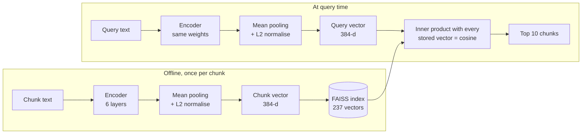
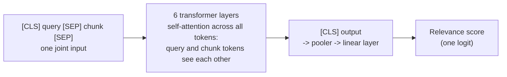
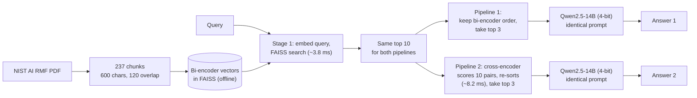

# RAG Assignment: Bi-Encoder Baseline vs. Cross-Encoder Re-Ranking

**Author:** Narasimha Pai  
**Code:** https://github.com/NJP6969/rag-baseline-vs-reranking (main notebook: [`notebooks/rag_baseline_vs_reranking.ipynb`](notebooks/rag_baseline_vs_reranking.ipynb))  
**Corpus:** NIST AI Risk Management Framework (AI RMF 1.0, NIST AI 100-1), 48 pages, 237 chunks (600 characters, 120 overlap)  
**Setup:** all-MiniLM-L6-v2 + FAISS (`IndexFlatIP`), ms-marco-MiniLM-L-6-v2 re-ranker, Qwen2.5-14B-Instruct (4-bit NF4, greedy decoding) on one RTX 3080 Ti (Ada `gnode103`)

## 1. Architecture comparison

**Bi-encoder** (all-MiniLM-L6-v2): query and chunk are encoded separately.

**Cross-encoder** (ms-marco-MiniLM-L-6-v2): query and chunk are read together, so it has to run once per (query, chunk) pair.

**How they are combined into the two pipelines:**

A bi-encoder embeds the query and each chunk separately, mean-pools each into a single 384-d vector, and compares them with cosine similarity. Since a chunk's vector doesn't depend on the query, I computed all 237 chunk vectors once and stored them in a FAISS index. At query time only the query has to be encoded, which took about 3.8 ms. The downside is that a whole 600-character chunk gets squeezed into one vector. That vector captures the general topic, but small words that change the meaning, like "not", "unless" or "prohibited", or a synonym, barely move it. So the bi-encoder tends to pick chunks that share the query's topic even when they don't answer it.

A cross-encoder takes the query and the chunk together as one input. Self-attention runs across both in every layer, so query tokens and chunk tokens can attend to each other directly. The output is one relevance score (a raw logit) computed from the `[CLS]` position. That makes it much better at telling whether a passage actually answers the question, such as whether a negation in the query matches a restriction in the text. The cost is that nothing can be precomputed: every (query, chunk) pair needs its own forward pass.

## 2. Rank shifts and answer comparison

I hand-wrote 33 candidate queries across the failure categories and paired each one with a phrase from the passage that actually answers it. A script ([`scripts/find_failure_queries.py`](scripts/find_failure_queries.py)) then checked where that passage ranked under each pipeline:

- 17 already had the answer in the bi-encoder's top 3.
- 9 had it below rank 10, so the re-ranker never saw it.
- 2 had it at ranks 4–10, and the cross-encoder didn't promote it.
- 5 had it at ranks 4–10, and the cross-encoder moved it into the top 3.

I used those 5 (F1–F5), plus one stage-1 miss (S1).

| ID | Type | Answer chunk (page) | Bi rank → CE rank | Effect on the answer |
|---|---|---|---|---|
| F1 | exception / stop rule | chunk_0051 (p.13) | #9 → #1 | Baseline wrongly said no such rule exists; re-ranked answer got it right |
| F2 | negation | chunk_0096 (p.21) | #4 → #1 | Baseline hedged and reasoned on its own; re-ranked answer quoted the document |
| F3 | caveat / exception | chunk_0098 (p.21) | #5 → #1 | Baseline missed it entirely; re-ranked answer found the resource and proprietary-info limits |
| F4 | keyword / synonym trap | chunk_0092 (p.20) | #5 → #1 | Baseline guessed "robustness"; re-ranked answer correctly said "resilience" |
| F5 | buried chunk | chunk_0102 (p.22) | #4 → #3 | Chunk moved, but both answers were the same |
| S1 | stage-1 miss | chunk_0130 (p.28) | #29 → not in top 10 | Both answers failed |

**F1** is the clearest case. The query was *"Is there any situation in which the framework says AI development should be stopped entirely?"*. The bi-encoder's top 3 were general framework chunks (chunk_0013, chunk_0191, chunk_0176), and the actual rule sat at #9. Answer 1 said *"no explicit directive to cease AI development is mentioned"*, which is wrong. It isn't a made-up fact, but the model concluded the rule doesn't exist because it never saw it. The cross-encoder gave chunk_0051 the highest score in the batch (+1.19) and dropped chunk_0013 from #1 to #10. Answer 2 then said development and deployment should cease when risks are unacceptable, and cited page 13.

**F2.** The baseline's top 3 were chunks that talk about transparency positively. The chunk with *"A transparent system is not necessarily an accurate, privacy-enhanced, secure, or fair system"* was at #4. Answer 1 actually reached the right conclusion, but it said the context didn't state it, so it was the model's own inference rather than something grounded in the text. After re-ranking, Answer 2 quoted the document.

**F4.** The query says "bounce back". The document calls this *resilience*, defined as *"the ability to return to normal function after an unexpected adverse event"*. That chunk also talks about security, and the query vector didn't land close enough to it, so it was at #5. Answer 1 said the term wasn't defined and guessed robustness. The cross-encoder put chunk_0092 at #1 (score +3.12), and Answer 2 correctly called it resilience.

**F5 and S1 show the limits.** In F5 the answer chunk moved from #4 to #3, but the two answers were basically the same. The baseline's top 3 (chunk_0101, chunk_0100, chunk_0099, all on page 21) already had both definitions. A rank promotion only changes the answer if it brings in information the baseline context didn't already have. In S1 the decommissioning passage (GOVERN 1.7, chunk_0130) was at #29, so the cross-encoder never saw it, and both answers were vague non-answers. Re-ranking can only reorder what stage 1 retrieves, so stage-1 recall is the ceiling.

**Extra: retrieval quality over all 33 candidate queries.** Each query has a known answer chunk, so I could also score both orderings over the whole candidate set ([`data/failure_query_search.json`](data/failure_query_search.json)):

| Metric (33 queries) | Bi-encoder order | After cross-encoder |
|---|---|---|
| Answer chunk at #1 (Hit@1) | 12 (36%) | 17 (52%) |
| Answer chunk in top 3 (Hit@3, what the LLM sees) | 17 (52%) | 22 (67%) |
| MRR@10 | 0.471 | 0.587 |
| Answer chunk in top 10 (the ceiling for both) | 24 (73%) | 24 (73%) |

The cross-encoder never pushed a correct chunk *out* of the top 3. Of the 11 queries still missing after re-ranking, 9 are stage-1 recall failures and 2 were in the top 10 but not promoted. These queries were written to probe failure cases, so the numbers show the direction of the effect rather than a general benchmark.

## 3. Latency

Each stage was timed over 20 runs after a warm-up. The table shows medians, with p95 in brackets, on one RTX 3080 Ti.

| ID | Stage 1: retrieve top 10 | Stage 2: re-rank 10 | Answer 1 gen (tokens) | Answer 2 gen (tokens) | Pipeline 1 total | Pipeline 2 total |
|---|---|---|---|---|---|---|
| F1 | 3.85 ms (3.93) | 8.41 ms (8.43) | 6,215 ms (99) | 4,313 ms (68) | 6,219 ms | 4,326 ms |
| F2 | 3.83 ms (3.85) | 8.07 ms (8.09) | 7,677 ms (125) | 5,860 ms (95) | 7,681 ms | 5,872 ms |
| F3 | 3.83 ms (3.85) | 7.78 ms (7.82) | 5,218 ms (84) | 6,686 ms (108) | 5,221 ms | 6,698 ms |
| F4 | 3.86 ms (3.90) | 8.36 ms (8.38) | 7,648 ms (124) | 8,803 ms (143) | 7,652 ms | 8,816 ms |
| F5 | 3.73 ms (3.75) | 8.07 ms (8.10) | 9,671 ms (157) | 7,692 ms (124) | 9,675 ms | 7,704 ms |
| S1 | 3.86 ms (3.87) | 8.60 ms (9.02) | 9,494 ms (155) | 6,457 ms (104) | 9,497 ms | 6,470 ms |
| **Mean** | **3.83 ms** | **8.22 ms** | **7,654 ms (124)** | **6,635 ms (107)** | **7,658 ms** | **6,647 ms** |

Re-ranking adds about 8 ms per query. That's around 0.13% of the total, because generation takes 4.3–9.7 s at about 16 tokens/s. Pipeline 2 was faster on average, but only because its answers happened to be shorter. In F1 and F2 the hedging baseline answers were longer, but in F3 and F4 the re-ranked answers were the longer ones. Total time comes down to how long the answer is, not to the retrieval method.

## 4. Why not cross-encode the whole collection?

The cross-encoder has to run once per chunk for every query, and nothing can be cached. I measured it in the notebook. Scoring all 237 chunks for one query took 103 ms (0.43 ms per pair, batched). The bi-encoder plus FAISS search over the same chunks took 4.1 ms.

Extrapolating the per-pair cost:

| Chunks | Cross-encode everything | Re-rank top 10 only |
|---|---|---|
| 237 | 0.10 s | 0.004 s |
| 10,000 | 4.3 s | 0.004 s |
| 1,000,000 | ~7.2 min | 0.004 s |
| 100,000,000 | ~12 h | 0.004 s |

The last column is only stage 2. Stage 1 adds to it: 4.1 ms here with a flat index, which is O(N·D). At millions of chunks you would need an approximate index like HNSW, which I didn't test. Throughput is a problem too. One GPU managed about 2,300 pairs per second, while 1,000 queries per second over 10,000 chunks would need 10 million pairs per second.

That's why the two stages split the work. The bi-encoder does one offline pass over the corpus, and then each query only needs a cheap index lookup to narrow the collection down to 10 candidates. The cross-encoder then runs on just those 10, so its cost stays fixed at about 8 ms no matter how big the collection gets. The trade-off, as S1 shows, is that anything stage 1 misses is gone for good. So stage-1 recall is the thing to improve next, for example by retrieving more candidates or adding a keyword-based retriever.
